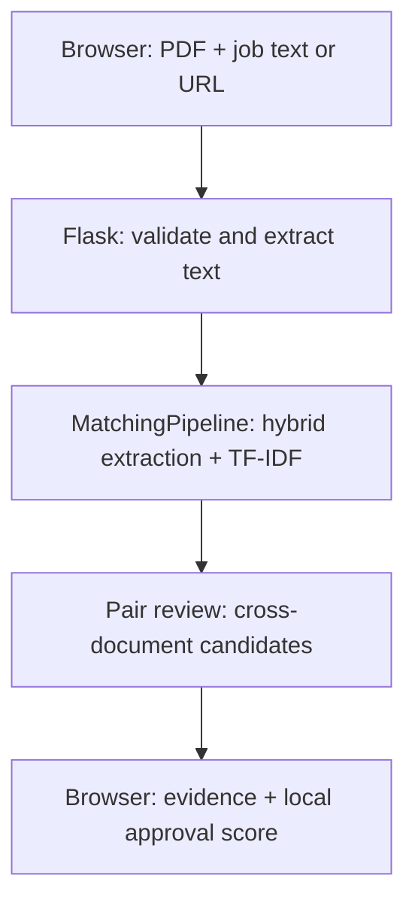

# Architecture

[Documentation home](../README.md#engineering-guide)

## Runtime boundaries

The reusable Python package lives in `src/resume_matcher`. The Flask adapter,
URL importer, and pair-review builder live at the repository root. The web
files are not packaged by the current setuptools `src` package discovery: run
the website from a repository checkout, not from a wheel alone.

## Request lifecycle

1. `static/app.js` submits multipart form data to `/api/compare`.
2. `web_app.py` validates inputs and writes the PDF into a temporary directory.
   `document_loader.py` reads its text; the temporary directory is removed before
   model initialization. A job URL instead invokes `job_links.fetch_job_text`.
3. A nonblocking lock gates model initialization and comparison. The first valid
   request builds one pipeline; later requests reuse it. This lock and cache are
   per Flask app instance/process, not global across a deployment.
4. `MatchingPipeline.analyze` extracts hybrid mentions for both documents,
   compares confirmed identifiers, and calculates separate TF-IDF similarity.
5. `serialize_report` emits the baseline report and invokes `build_pair_review`.
   The builder reuses the embedding model to compare extracted evidence phrases.
6. The browser calculates reviewed coverage from `requirements` and local
   decisions. Clicking buttons does not send a new request or retrain anything.

## Extraction flow

`load_skill_catalog` combines the ESCO CSV with the bundled supplemental CSV.
`ExactSkillExtractor` applies reviewed alias corrections, then spaCy
`PhraseMatcher(attr="LOWER")` finds token-based label matches. For identical
spans, an exact preferred label wins over aliases; unresolved multiple concepts
cause abstention. Nested spans are not globally eliminated.

`CandidatePhraseExtractor` uses the trained English parser to form short noun/
action phrases. It splits pipes and semicolons, filters generic ability phrases,
and limits candidates to six meaningful tokens by default with at least two
content tokens. It is a heuristic, not a general requirement parser.

`SemanticSkillMatcher` embeds eligible canonical preferred labels once at
initialization. It retrieves the closest label for each candidate in a batch.
The hybrid extractor requests top-1 with a default cutoff of 0.75. A grammatical
verifier may promote a retrieval to `grammatical` if ordered lemma signatures
match, ignoring articles and limited edge punctuation. Otherwise it remains
`semantic` and awaits review.

The hybrid output retains one mention per skill URI. Exact evidence takes
priority; among retrieved mentions, grammatical confirmation wins, then higher
similarity. The system therefore does not retain every occurrence or passage.

## Component map

| File | Responsibility |
| --- | --- |
| `skills.py` | Frozen `Skill` value object and raw ESCO loader. |
| `skill_catalog.py` | Supplemental concepts and in-memory alias transfers. |
| `alias_rules.py` | Validate/load add/block alias rules. |
| `skill_extractor.py` | Exact matching, span ambiguity, contextual aliases. |
| `candidate_phrases.py` | Parser-based semantic candidate generation. |
| `semantic_matcher.py` | Pretrained model, catalog embeddings, batch retrieval. |
| `match_confirmation.py` | Conservative grammatical equivalence. |
| `hybrid_extractor.py` | Evidence source, deduplication, retrieval orchestration. |
| `skill_gap.py` | URI set comparison and confirmed coverage. |
| `preprocessing.py`, `tfidf.py` | Tokenization and lexical baseline. |
| `document_loader.py` | TXT/PDF/DOCX extraction. |
| `matching_pipeline.py` | Reusable text/document comparison service. |
| Root `pair_review.py` | Fixed requirements and suggested cross-document pairs. |
| Root `web_app.py`, `job_links.py` | HTTP boundary and bounded public-page import. |
| `static/review.js` | Pure reviewed-coverage calculation. |
| `static/app.js` | Upload UI, rendering, and ephemeral decisions. |

## Data contracts

- `Skill`: stable URI, preferred label, aliases, skill type, contextual aliases/
  headings, and semantic eligibility.
- `SkillMention`: exact evidence with character offsets.
- `HybridSkillMention`: skill, original phrase, source, similarity, and derived
  `is_confirmed`. Hybrid mentions do not retain exact character offsets.
- `ResumeJobMatchReport`: résumé mentions, job mentions, confirmed `SkillGapReport`,
  and TF-IDF score. Semantic suggestions are derived properties.
- A web requirement row: URI, display label, job excerpts, confirmation flag,
  automatic-match flag, and up to three review candidates.

## Performance and extension boundaries

Catalog embeddings are rebuilt for each matcher construction; there is no
project-managed persistent embedding index. Models may be cached by their
upstream libraries. Pair review encodes both sides' extracted phrases and builds
a dense job-by-résumé similarity matrix. Multiple workers duplicate model memory;
the single-process lock does not provide a queue or cross-worker throttling.

Keep scoring in `review.js` testable independently of the DOM. Preserve URI
identity when changing labels. If moving review state to a server/database,
introduce comparison IDs, versioned requirement snapshots, authorization, and
explicit retention; these are not implemented today.
